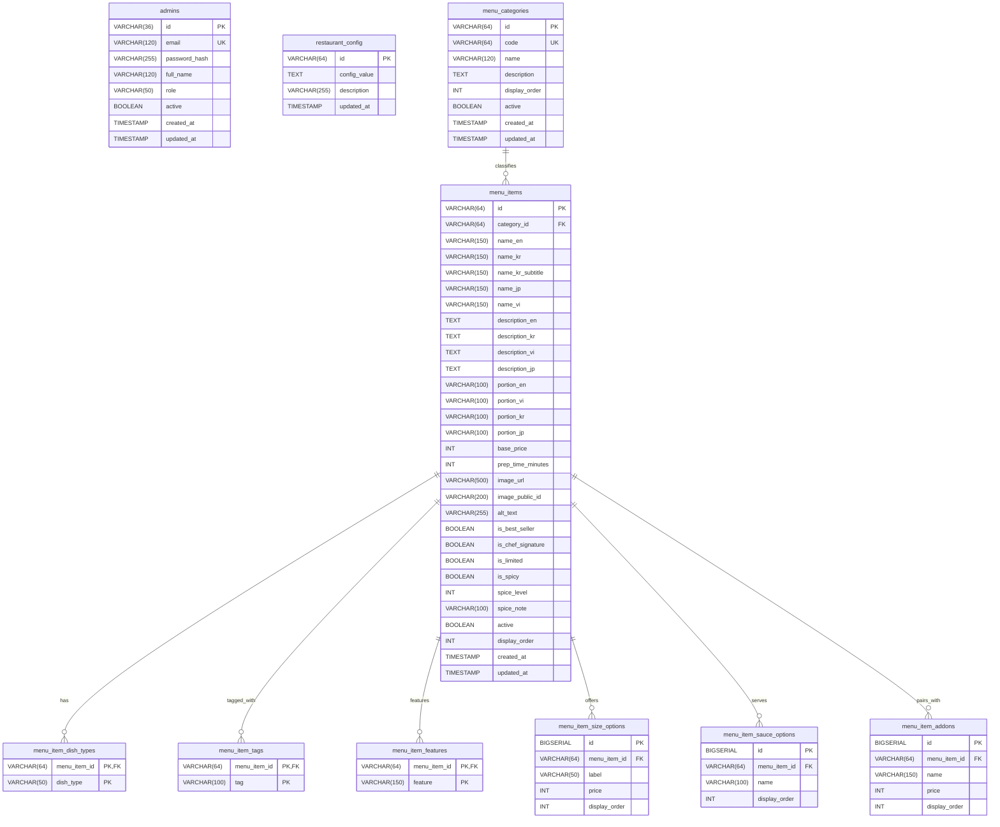

# Cutlet Spring - Database Architecture & Schema Design

## 1. Overview

Cutlet Spring utilizes **PostgreSQL 16** as its primary relational datastore with **Flyway** for automated, version-controlled schema migrations.

- **Dialect**: PostgreSQL 16 (H2 in PostgreSQL mode for unit/integration tests).
- **Naming Conventions**: `snake_case` for tables and columns; UUID or semantic slug strings for primary keys.
- **Auditing**: All primary tables include `created_at` and `updated_at` timestamps.

---

## 2. Entity-Relationship Diagram (ERD)

---

## 3. Flyway Database Migrations

Database migrations are located in `be/src/main/resources/db/migration/`:

| Version | Migration Script | Description |
|---|---|---|
| `V1` | `V1__create_admin_and_config_tables.sql` | Provisions `admins` and `restaurant_config` tables with initial counter capacity configuration. |
| `V2` | `V2__create_category_tables.sql` | Provisions `menu_categories` table with display ordering and unique code indexes. |
| `V3` | `V3__create_menu_tables.sql` | Provisions `menu_items`, `menu_item_dish_types`, `menu_item_tags`, and `menu_item_features` tables. |
| `V4` | `V4__create_menu_options_tables.sql` | Provisions `menu_item_size_options`, `menu_item_sauce_options`, and `menu_item_addons` with cascade foreign keys. |
| `V5` | `V5__seed_initial_data.sql` | Seeds all 7 dining categories, 38 authentic Cutlet Spring dishes (with full EN/KR/JP/VI multilingual texts), options, and default administrator credentials. |
| `V6` | `V6__create_password_reset_tokens_table.sql` | Provisions `password_reset_tokens` table with foreign key to `admins`, hashed credentials, expiration timestamps, and performance indexes. |

---

## 4. Table Specifications

### 4.1 `admins`
Stores restaurant management credentials.
- `id` (VARCHAR 36): Primary key UUID.
- `email` (VARCHAR 120, UNIQUE): Administrator login email.
- `password_hash` (VARCHAR 255): BCrypt password hash.
- `role` (VARCHAR 50): Security role (`ROLE_ADMIN`).
- `active` (BOOLEAN): Status flag.

### 4.2 `menu_categories`
Organizes dishes into atelier dining sections.
- `id` / `code`: Semantic identifier (`japanese`, `korean`, `curry`, `noodles`, `addons`, `sauces`, `drinks`).
- `name`: English display label.
- `display_order`: Integer defining sort order on the menu bar and page scroll.

### 4.3 `menu_items`
Core culinary dish specifications.
- `base_price`: Integer in thousands VND (e.g. `200` represents 200,000 VND).
- `image_url`: HTTPS URL to the Cloudinary asset or local fallback.
- `image_public_id`: Cloudinary asset public ID for secure deletion / replacement.
- `is_chef_signature`, `is_best_seller`, `is_limited`, `is_spicy`: Visual flags.
- `prep_time_minutes`: Kitchen preparation duration (e.g. 15 or 20 minutes).
- `active`: Visibility flag on the public guest menu.

### 4.4 Normalized Collections
- `menu_item_size_options`: Size variants (e.g. `S` for 150k, `L` for 180k).
- `menu_item_sauce_options`: Available artisanal sauces (e.g. Classic Sauce, Spicy Sauce, Dual Sauce).
- `menu_item_addons`: Pairings (e.g. Extra Tenderloin 1pc, King Tiger Shrimp, Curry Sauce Bowl).

### 4.5 `password_reset_tokens`
Manages secure password recovery lifecycle through email OTP and single-use reset tokens.
- `id` (VARCHAR 36): Primary key UUID.
- `admin_id` (VARCHAR 36): Foreign key references `admins(id)` with ON DELETE CASCADE.
- `otp_hash` (VARCHAR 255): BCrypt salted hash of the 6-digit verification code.
- `reset_token_hash` (VARCHAR 255): SHA-256 hash of the single-use 64-hex reset token.
- `expires_at` (TIMESTAMP WITH TIME ZONE): OTP expiration cutoff (5 minutes from creation).
- `token_expires_at` (TIMESTAMP WITH TIME ZONE): Reset token validity cutoff (10 minutes from verification).
- `verified_at` (TIMESTAMP WITH TIME ZONE): Recorded when the OTP is successfully validated.
- `consumed_at` (TIMESTAMP WITH TIME ZONE): Recorded when the password reset is finalized.
- `attempt_count` (INT): Tracks consecutive failed OTP attempts (locks out after 5 failures).
- `resend_count` (INT): Tracks re-request frequency under a 60-second cooldown window.
- **Indexes**: `idx_pwd_reset_admin_id`, `idx_pwd_reset_expires_at`, `idx_pwd_reset_token_expires_at`, `idx_pwd_reset_reset_token_hash`.
- **Automated Lifecycle**: Background scheduled cleanup job (`PasswordResetCleanupService`) executes every hour to purge records expired/consumed beyond 24 hours.

### 4.6 `restaurant_settings`
Added in Flyway migration `V7`. Holds complete 4-language atelier profile, service shift timings, and dining policies.
- `id` (VARCHAR 50): Primary key (default `'default'`).
- `name_en`, `name_kr`, `name_vi`, `name_jp`: Mandatory 4-language restaurant names.
- `slogan_en`, `slogan_kr`, `slogan_vi`, `slogan_jp`: Atelier slogans in 4 languages.
- `description_en`, `description_kr`, `description_vi`, `description_jp`: Overview and heritage texts in 4 languages.
- `address_en`, `address_kr`, `address_vi`, `address_jp`: Atelier street address in 4 languages.
- `phone_number` (VARCHAR 50), `email` (VARCHAR 100): Atelier contact endpoints.
- `logo_url`, `logo_public_id`, `banner_url`, `banner_public_id`: Cloudinary media references.
- `opening_hour_lunch_start`, `opening_hour_lunch_end`: Lunch shift hours (`11:00` - `15:00`).
- `opening_hour_dinner_start`, `opening_hour_dinner_end`: Dinner shift hours (`17:00` - `21:00`).
- `last_order_time`: Kitchen cutoff (`20:30`).
- `closed_days_en`, `closed_days_kr`, `closed_days_vi`, `closed_days_jp`: Multilingual closing schedules.
- `policy_one_dish_en`..`_jp`: One main dish per guest policy across all 4 languages.
- `policy_vat_en`..`_jp`: VAT tax explanation in 4 languages.
- `policy_takeout_en`..`_jp`: Takeout crispness preservation policy in 4 languages.
- `vat_rate` (NUMERIC 5,2), `default_prep_minutes` (INT), `capacity_hall` (INT 30), `capacity_counter` (INT 10).

### 4.7 `account_audit_logs`
Added in Flyway migration `V7`. Records security-critical administrative actions for compliance and operator oversight.
- `id` (VARCHAR 36): Primary key UUID.
- `admin_email` (VARCHAR 255): Email of the administrator or staff member who performed the action.
- `admin_name` (VARCHAR 255): Full name of the operator.
- `action` (VARCHAR 100): Identifier of the event (`CREATE_ACCOUNT`, `UPDATE_ACCOUNT`, `ACTIVATE_ACCOUNT`, `DEACTIVATE_ACCOUNT`, `RESET_PASSWORD`, `UPDATE_RESTAURANT_SETTINGS`, `UPLOAD_LOGO`, `UPLOAD_BANNER`).
- `target_type` (VARCHAR 100), `target_id` (VARCHAR 255): Target entity reference.
- `details` (TEXT): Human-readable event description.
- `ip_address` (VARCHAR 100): Remote client IP address.
- `created_at` (TIMESTAMP WITH TIME ZONE): Event timestamp.
- **Indexes**: `idx_audit_created_at`, `idx_audit_admin_email`.

### 4.8 `homepage_sections`
Added in Flyway migration `V8`. Manages the dynamic sections on the customer home page, their sequential ordering, and active visibility.
- `id` (VARCHAR 50): Primary key (e.g. `'sec-hero'`, `'sec-ingredients'`, `'sec-reviews'`, `'sec-location'`, `'sec-info'`).
- `section_key` (VARCHAR 50 UNIQUE): Unique programmatic section key (`hero`, `ingredients`, `reviews`, `location`, `info`).
- `title_en`, `title_kr`, `title_vi`, `title_jp`: Section title in all 4 languages.
- `subtitle_en`, `subtitle_kr`, `subtitle_vi`, `subtitle_jp`: Section subtitle in all 4 languages.
- `display_order` (INT): Presentation sequence on the public page.
- `is_active` (BOOLEAN): Toggle section visibility on/off.
- `created_at`, `updated_at` (TIMESTAMP WITH TIME ZONE).

### 4.9 `homepage_hero_contents`
Added in Flyway migration `V8`. Eliminates hardcoded headlines and descriptions in the hero header.
- `id` (VARCHAR 50): Primary key (`'default-hero'`).
- `title_en`..`_jp`, `headline_en`..`_jp`, `tagline_en`..`_jp`: 4-language headings and subheadings.
- `description_en`..`_jp` (TEXT): 4-language editorial body copy.
- `cta_text_en`..`_jp`: 4-language call-to-action button labels.
- `cta_target`: Destination route (`menu`).
- `image_url`, `image_public_id`: Cloudinary hero visual media.
- `badge_text_en`..`_jp`: Overline badge (e.g. "Established 2023").
- `dish_title_en`..`_jp`, `dish_desc_en`..`_jp`: Signature dish highlight badge.
- `metric1_value`..`metric3_value` & `metric1_label_en`..`metric3_label_jp`: Bento metrics bar (120h wet aging, 100% chilled non-frozen, fresh daily bakery panko).
- `is_active` (BOOLEAN).

### 4.10 `ingredients`
Added in Flyway migration `V8`. Holds the atelier's 4 core foundation ingredients and any future culinary additions with full 4-language descriptions and Cloudinary images.
- `id` (VARCHAR 50): Semantic slug primary key (`'chilled-pork'`, `'breadcrumbs'`, `'tonkatsu-sauce-dressing'`, `'cabbage'`).
- `name_en`..`_jp`: Ingredient name in all 4 languages.
- `subtitle_en`..`_jp`: Subtitle highlighting technique (e.g. "120-Hour Wet Aging", "Daily In-House Bakery Panko").
- `description_en`..`_jp` (TEXT): Detailed craft descriptions in all 4 languages.
- `image_url`, `image_public_id`: Cloudinary image asset.
- `display_order` (INT), `is_active` (BOOLEAN).

### 4.11 `google_reviews`
Added in Flyway migration `V8`. Manages curated Google Maps reviews and verified owner replies.
- `id` (VARCHAR 50): Primary key (e.g. `'review-vietnamese'`, `'review-korean'`, `'review-english'`, `'review-japanese'`).
- `reviewer_name` (VARCHAR 255): Diner's name.
- `reviewer_initials` (VARCHAR 10): 2-character avatar initials.
- `reviewer_avatar_url` (VARCHAR 500): Optional avatar image URL.
- `reviewer_metadata` (VARCHAR 255): Credential badge (e.g. "Local Guide · 85 reviews · 232 photos").
- `rating` (INT): 1 to 5 stars.
- `review_language` (VARCHAR 10): Native review language (`VI`, `KR`, `EN`, `JA`).
- `review_content` (TEXT): Original quote.
- `review_date` (VARCHAR 100): Date string.
- `owner_response` (TEXT), `owner_response_date` (VARCHAR 100): Restaurant owner's verified reply.
- `review_url` (VARCHAR 500): Direct link to the review on Google Maps.
- `is_featured` (BOOLEAN): Whether showcased in featured cards.
- `is_active` (BOOLEAN): Publication toggle.
- `display_order` (INT).

