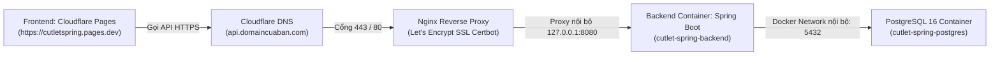

# Kế hoạch & Hướng dẫn Thiết lập VPS Mới từ A-Z (Docker + Nginx + SSL + Cloudflare)

Tài liệu này là quy trình chuẩn hóa dành cho DevOps khi chuyển đổi hoặc tạo mới VPS để chạy Cutlet Spring Backend, tích hợp đầy đủ HTTPS (Let's Encrypt SSL), tường lửa và kết nối với Frontend Cloudflare Pages.

---

## 1. Tổng quan Kiến trúc Hệ thống



---

## 2. Bảng thông số & Biến cần chuẩn bị

| Hạng mục | Ví dụ | Mô tả |
| :--- | :--- | :--- |
| **IP VPS Mới** | `103.xxx.xxx.xxx` | IP do nhà cung cấp cấp khi mua VPS |
| **User SSH** | `root` | Tài khoản quản trị VPS |
| **Tên miền API** | `api.cutletspring.com` | Subdomain dành riêng cho backend API |
| **Frontend URL** | `https://cutletspring.pages.dev` | Domain Cloudflare Pages hiện có |
| **Thư mục ứng dụng** | `/opt/cutletspring` | Đường dẫn chứa file compose và env trên VPS |

---

## 3. Quy trình thực hiện chi tiết (7 Giai đoạn)

### Giai đoạn 1: Đăng nhập & Cấu hình bảo mật ban đầu trên VPS mới

1. **Đăng nhập vào VPS mới qua SSH**:
   ```bash
   ssh root@<IP_VPS_MOI>
   ```

2. **Cài đặt SSH Deployment Key** *(Để GitHub Actions và máy bạn SSH không cần mật khẩu)*:
   ```bash
   mkdir -p ~/.ssh && chmod 700 ~/.ssh
   # Dán Public Key của cutlet_deploy vào authorized_keys:
   echo "ssh-ed25519 AAAAC3NzaC1lZDI1NTE5AAAAIM1MvQmwNWTCBdYoerQQQTM0Hi9IccCjNGfTAfPqRKKI cutlet-deploy" >> ~/.ssh/authorized_keys
   chmod 600 ~/.ssh/authorized_keys
   ```

3. **Tạo 2GB–4GB Swap RAM** *(Bảo vệ VPS 1GB/2GB không bị sập khi tải cao)*:
   ```bash
   # Kiểm tra swap hiện có
   free -m

   # Nếu Swap = 0, chạy chuỗi lệnh sau để tạo 2GB Swap:
   fallocate -l 2G /swapfile
   chmod 600 /swapfile
   mkswap /swapfile
   swapon /swapfile
   echo '/swapfile none swap sw 0 0' >> /etc/fstab
   ```

---

### Giai đoạn 2: Cài đặt Docker & Tường lửa (UFW)

1. **Cài đặt Docker Engine & Docker Compose**:
   ```bash
   apt-get update
   DEBIAN_FRONTEND=noninteractive apt-get install -y ca-certificates curl gnupg
   install -m 0755 -d /etc/apt/keyrings
   curl -fsSL https://download.docker.com/linux/ubuntu/gpg -o /etc/apt/keyrings/docker.asc
   chmod a+r /etc/apt/keyrings/docker.asc

   echo "deb [arch=amd64 signed-by=/etc/apt/keyrings/docker.asc] https://download.docker.com/linux/ubuntu $(lsb_release -cs) stable" > /etc/apt/sources.list.d/docker.list
   apt-get update

   DEBIAN_FRONTEND=noninteractive apt-get install -y docker-ce docker-ce-cli containerd.io docker-compose-plugin docker-buildx-plugin
   systemctl enable docker && systemctl start docker
   ```

2. **Cấu hình tường lửa UFW**:
   ```bash
   # Cho phép SSH, HTTP, HTTPS, chặn 5432 Postgres khỏi internet
   ufw allow 22/tcp
   ufw allow 80/tcp
   ufw allow 443/tcp
   ufw deny 5432/tcp
   echo y | ufw enable
   ```

---

### Giai đoạn 3: Cấu hình DNS trên Cloudflare

1. Đăng nhập vào trang quản trị **Cloudflare Dashboard** ➔ Chọn Domain của bạn.
2. Vào mục **DNS** ➔ **Records** ➔ Bấm **Add record**:
   * **Type**: `A`
   * **Name**: `api` *(nếu muốn tạo `api.domaincuaban.com`)*
   * **IPv4 address**: `<IP_VPS_MOI>`
   * **Proxy status**: Để **DNS only** (Đám mây xám) trong lúc xin cấp SSL bằng Certbot lần đầu.
   * **TTL**: Auto ➔ Bấm **Save**.

---

### Giai đoạn 4: Cài đặt Nginx & Cấp chứng chỉ SSL Let's Encrypt (Certbot)

1. **Cài đặt Nginx và Certbot**:
   ```bash
   apt-get install -y nginx certbot python3-certbot-nginx
   ```

2. **Tạo file cấu hình Nginx Reverse Proxy**:
   ```bash
   nano /etc/nginx/sites-available/cutlet-api
   ```
   *Dán nội dung sau (thay `api.domaincuaban.com` bằng tên miền của bạn)*:
   ```nginx
   server {
       listen 80;
       server_name api.domaincuaban.com;

       location / {
           proxy_pass http://127.0.0.1:8080;
           proxy_http_version 1.1;
           proxy_set_header Host $host;
           proxy_set_header X-Real-IP $remote_addr;
           proxy_set_header X-Forwarded-For $proxy_add_x_forwarded_for;
           proxy_set_header X-Forwarded-Proto $scheme;
       }
   }
   ```

3. **Kích hoạt Virtual Host Nginx**:
   ```bash
   ln -s /etc/nginx/sites-available/cutlet-api /etc/nginx/sites-enabled/
   rm -f /etc/nginx/sites-enabled/default
   nginx -t && systemctl reload nginx
   ```

4. **Xin chứng chỉ SSL miễn phí (Certbot)**:
   ```bash
   certbot --nginx -d api.domaincuaban.com --non-interactive --agree-tos -m admin@cutletspring.com
   ```
   > [!NOTE]
   > Certbot sẽ tự động chèn cấu hình SSL port 443 vào Nginx và tự động tạo tiến trình Cron/Systemd Timer để gia hạn SSL trọn đời mà không cần thao tác lại.
   > Sau khi Certbot chạy xong, trên Cloudflare bạn có thể bật lại đám mây cam (**Proxied**) nếu muốn dùng thêm CDN/DDoS Protection của Cloudflare (chọn SSL Mode là **Full** hoặc **Full (strict)**).

---

### Giai đoạn 5: Chuẩn bị thư mục & File cấu hình ứng dụng trên VPS

1. **Tạo cấu trúc thư mục trên VPS**:
   ```bash
   mkdir -p /opt/cutletspring/be /opt/cutletspring/backups
   chmod 755 /opt/cutletspring
   ```

2. **Copy `docker-compose.prod.yml` sang VPS**:
   * Chạy từ PowerShell máy bạn:
     ```powershell
     scp -i "$env:USERPROFILE\.ssh\cutlet_deploy" docker-compose.prod.yml root@<IP_VPS_MOI>:/opt/cutletspring/docker-compose.prod.yml
     ```

3. **Copy hoặc tạo file `be/.env` trên VPS**:
   * Chạy từ PowerShell máy bạn:
     ```powershell
     scp -i "$env:USERPROFILE\.ssh\cutlet_deploy" be/.env root@<IP_VPS_MOI>:/opt/cutletspring/be/.env
     ```
   * Phân quyền bảo mật file `.env`:
     ```bash
     chmod 600 /opt/cutletspring/be/.env
     ```

---

### Giai đoạn 6: Khởi chạy và Kiểm tra hệ thống

1. **Khởi chạy PostgreSQL và Backend**:
   ```bash
   cd /opt/cutletspring
   docker compose -f docker-compose.prod.yml pull backend
   docker compose -f docker-compose.prod.yml up -d
   ```

2. **Kiểm tra trạng thái**:
   ```bash
   docker compose -f docker-compose.prod.yml ps
   ```
   *(Cả `cutlet-spring-postgres` và `cutlet-spring-backend` phải ở trạng thái `healthy`).*

3. **Kiểm tra Endpoint HTTPS qua tên miền**:
   ```bash
   curl -s https://api.domaincuaban.com/actuator/health
   # Kết quả: {"status":"UP", ...}
   ```

---

### Giai đoạn 7: Cập nhật CI/CD GitHub & Cloudflare Pages

1. **Cập nhật Secrets trên GitHub Repository**:
   Vào **Repo** > **Settings** > **Secrets and variables** > **Actions**:
   * `VPS_HOST`: Cập nhật thành `<IP_VPS_MOI>`.
   * `VPS_KNOWN_HOSTS`: Chạy lệnh `ssh-keyscan -H <IP_VPS_MOI>` lấy chuỗi output dán vào.

2. **Cập nhật Biến môi trường trên Cloudflare Pages (Frontend)**:
   * Vào **Cloudflare Dashboard** > **Workers & Pages** > Chọn dự án Pages của bạn.
   * Vào **Settings** > **Environment variables**.
   * Cập nhật biến:
     ```text
     VITE_API_BASE_URL = https://api.domaincuaban.com/api
     ```
   * Vào tab **Deployments** > Bấm **Retry deployment** hoặc trigger deploy mới để Frontend nhận API HTTPS mới.

---

## 4. Tóm tắt Checklist kiểm tra khi hoàn thành

- [ ] SSH đăng nhập không cần mật khẩu bằng key `cutlet_deploy`.
- [ ] Tường lửa UFW: Cho phép 22, 80, 443; chặn 5432.
- [ ] Swap RAM: Đã bật từ 2GB đến 4GB.
- [ ] DNS Cloudflare: Bản ghi A `api` trỏ đúng IP VPS mới.
- [ ] Nginx + Certbot: `https://api.domaincuaban.com` có ổ khóa xanh hợp lệ.
- [ ] Backend: `https://api.domaincuaban.com/actuator/health` trả về `{"status":"UP"}`.
- [ ] Frontend: Đăng nhập Admin và gọi Menu không bị lỗi CORS hay Mixed Content.
